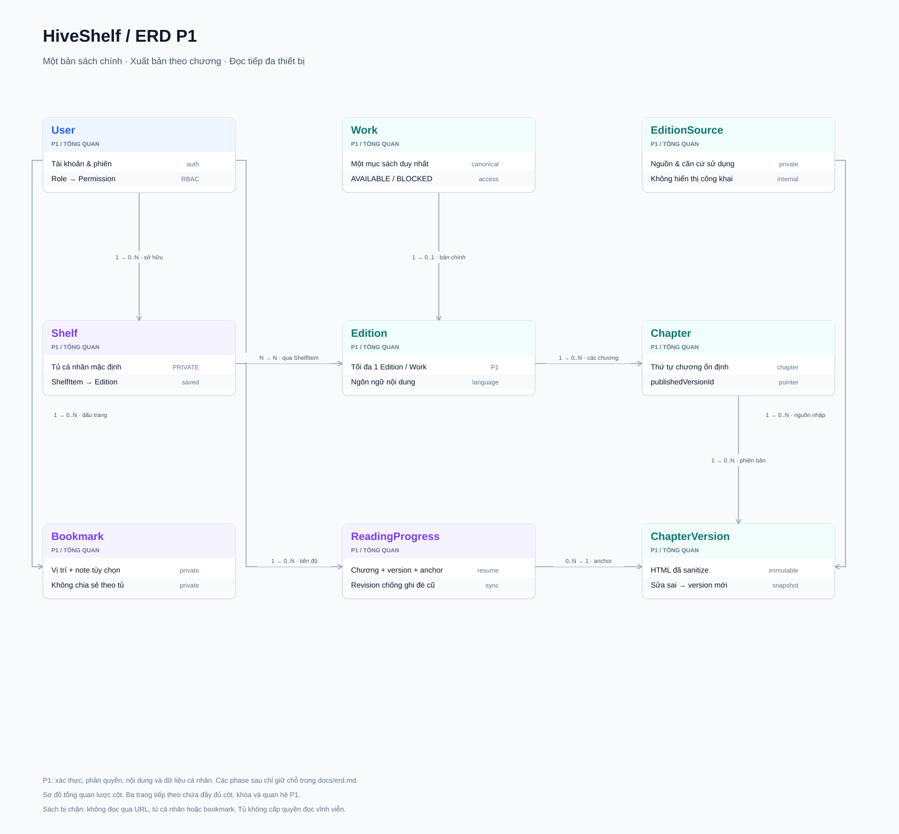
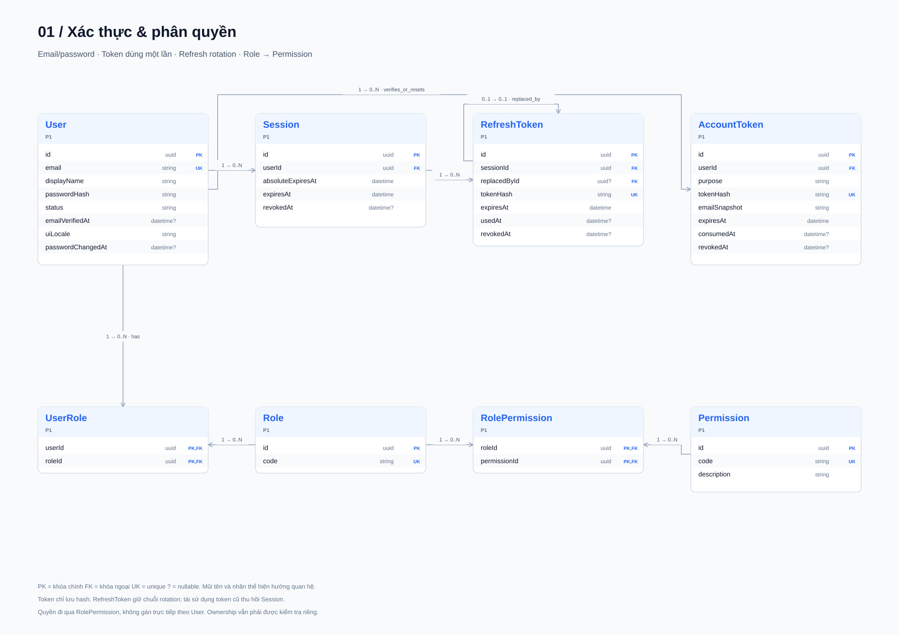
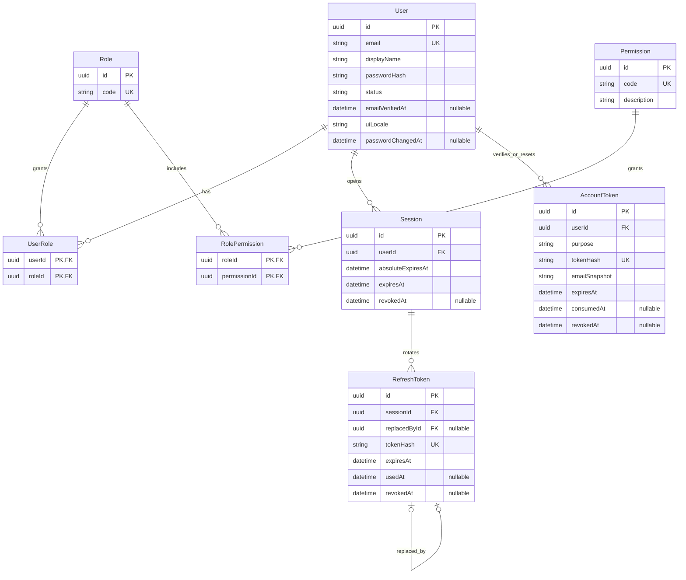
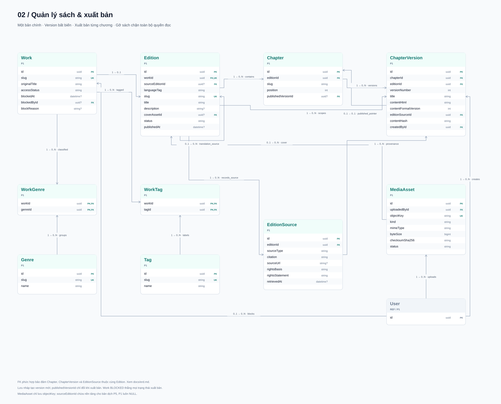
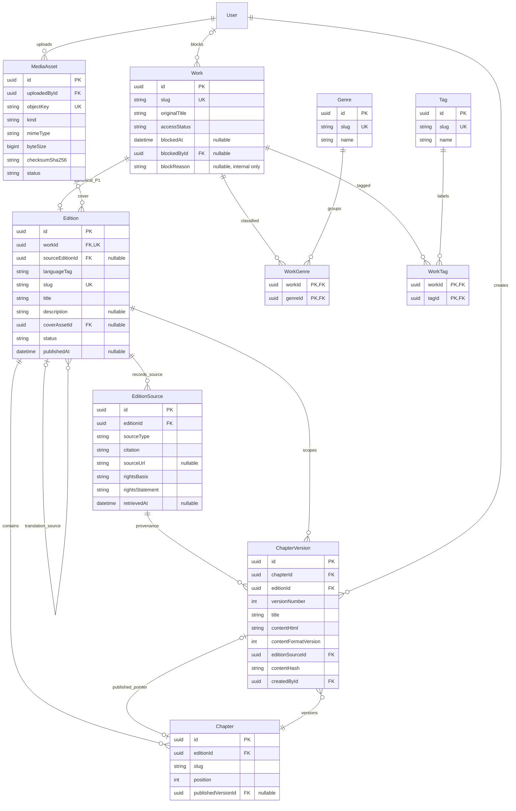
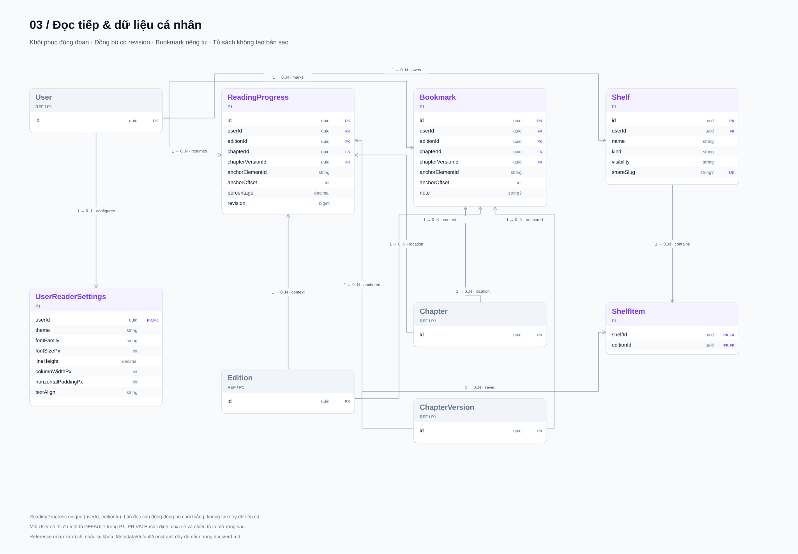
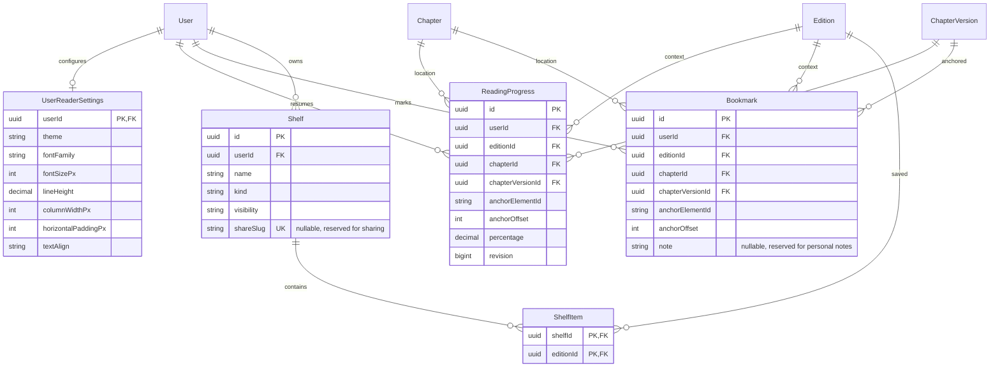
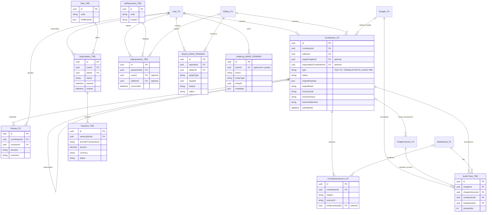

# ERD HiveShelf — P1: xác thực, quản lý sách và đọc sách

> Trạng thái: **Bản thiết kế P1 để review**, tổng hợp các quyết định trong phiên review
> và Epic E1, E3, E4, E5, E13, E16. Chi tiết kỹ thuật đề xuất được ghi riêng.
> Nguồn nghiệp vụ: nội dung Epic do chủ dự án cung cấp trong phiên review.
> Chưa có ID/link và Acceptance Criteria của từng story; chưa coi tài liệu là
> đặc tả đã duyệt cho US-3.1a. Chưa sửa Prisma hoặc tạo migration.

## Bản vẽ draw.io

[File draw.io chỉnh sửa được — 4 trang](diagrams/erd-p1.drawio): tổng quan,
xác thực/phân quyền, quản lý sách, và dữ liệu người đọc. Mở bằng draw.io qua
**File → Open From → Device**. Màu xanh dương: xác thực; xanh ngọc: nội dung;
tím: người đọc; xám: tham chiếu bảng ở nhóm khác.

Các sơ đồ SVG chi tiết nằm ở mục 3. Mermaid được giữ trong phần thu gọn để
review thay đổi dữ liệu bằng văn bản. Quy ước cột chung, enum và ràng buộc nằm
trong tài liệu này; hình không thay thế các CHECK/FK phức hợp.

## 1. Phạm vi và trạng thái phase

- **P1 đã xác nhận ở mức Epic:** email/password, xác thực email, reset/đổi mật khẩu,
  cookie httpOnly và refresh token rotation (E1); Admin nhập/sửa/xuất bản sách,
  sanitize HTML và script nhập sách phạm vi công cộng (E3); tìm kiếm/danh mục/SEO
  (E4); reader và đồng bộ cấu hình (E5); giao diện/email vi/en (E13); bảo mật và
  cổng kiểm tra (E16). Tiến độ đọc, bookmark và tủ sách cá nhân được xác nhận
  thêm theo định hướng MVP đọc và phiên review.
- **P2 — giữ chỗ:** quy trình đóng góp văn bản, duyệt và xem lịch sử phiên bản,
  theo phần ngoài phạm vi P1 của E3. ChapterVersion vẫn được tạo ở P1.
- **P5 — giữ chỗ:** đóng góp bản dịch nội dung; song ngữ/dịch máy P5+ theo E13.
- **Chưa xác định phase — giữ chỗ:** audio, thương mại, quảng cáo.
- **Chờ thông tin wave tiếp theo — giữ chỗ:** Report và AuditLog.
- **Mở rộng chưa chốt phase:** nhiều tủ sách tùy tạo, chia sẻ tủ sách và ghi chú
  cá nhân. Bản nháp đề xuất chừa cấu trúc từ P1, chưa coi các UI này thuộc MVP.

P1 không có OAuth Google, 2FA hay màn hình quản lý thiết bị. Backend Session
vẫn cần để refresh/logout/thu hồi. Preset reader, focus mode và lật trang chưa
được đưa vào schema. Staging, e2e, routing i18n và cookie không tự tạo bảng mới.

### Danh mục thực thể

| Nhóm          | Thực thể                                   | Phase / trạng thái                | Vai trò / thuộc tính chính                                                           |
| ------------- | ------------------------------------------ | --------------------------------- | ------------------------------------------------------------------------------------ |
| Định danh     | User                                       | P1 / E1, E13                      | Email, mật khẩu băm, xác thực email, trạng thái, uiLocale                            |
| Định danh     | Role, UserRole, Permission, RolePermission | P1 / MVP                          | Quyền theo role; mỗi user có nhiều role; chưa có quyền riêng theo user               |
| Định danh     | Session, RefreshToken                      | P1 / E1                           | Phiên và chuỗi token băm có rotation/reuse detection                                 |
| Định danh     | AccountToken                               | P1 / E1                           | Token dùng một lần cho verify email/reset password                                   |
| Nội dung      | Work                                       | P1 / E3                           | Tác phẩm, tiêu đề gốc, slug, trạng thái chặn truy cập                                |
| Nội dung      | Edition                                    | P1 / E3                           | Ngôn ngữ nội dung, metadata, nguồn dịch, bìa, trạng thái                             |
| Nội dung      | Chapter, ChapterVersion                    | P1 / E3                           | Chương ổn định, snapshot HTML đã sanitize, phiên bản xuất bản                        |
| Nội dung      | EditionSource                              | P1 / đề xuất đáp ứng nhập sách E3 | Nguồn nhập và snapshot căn cứ sử dụng, gắn từng ChapterVersion                       |
| Nội dung      | Genre, Tag, WorkGenre, WorkTag             | P1 / E3, E4                       | Phân loại và lọc tác phẩm                                                            |
| Đóng góp      | Contribution, ContributionSource, Review   | P2 — giữ chỗ                      | Bản gốc bất biến, giấy phép, nguồn và quyết định duyệt; dịch P5, audio chưa rõ phase |
| Người đọc     | UserReaderSettings                         | P1 / E5                           | Font, cỡ chữ, giãn dòng, theme, độ rộng, lề, căn lề                                  |
| Người đọc     | ReadingProgress, Bookmark                  | P1 / MVP đọc                      | Chương + phiên bản + anchor; bookmark riêng tư, note chừa mở rộng                    |
| Người đọc     | Shelf, ShelfItem                           | P1 / MVP đọc                      | Một tủ mặc định riêng tư; đề xuất cấu trúc hỗ trợ nhiều tủ và chia sẻ sau            |
| Thương mại    | Plan, Subscription, Payment                | Chưa rõ phase — giữ chỗ           | Gói, thời hạn đăng ký, giao dịch                                                     |
| Thương mại    | AdPlacement, AdImpression                  | Chưa rõ phase — giữ chỗ           | Vị trí quảng cáo, lượt hiển thị                                                      |
| Audio / media | MediaAsset                                 | P1 / E3                           | Metadata file bìa; mở rộng file audio/bằng chứng sau                                 |
| Audio / media | AudioTrack                                 | Chưa rõ phase — giữ chỗ           | Bản thu, phiên bản chương, file, thời lượng, provenance                              |
| Vận hành      | Report, AuditLog                           | Chờ wave tiếp theo — giữ chỗ      | Báo cáo và sự kiện vận hành; E16 chưa xác định yêu cầu DB audit                      |

### Phạm vi metadata và hiển thị đã chốt khi review

- Website ưu tiên nội dung đọc và đóng góp cộng đồng; P1 không có Author,
  authorDisplayName, ISBN, nhà xuất bản, năm xuất bản hoặc hồ sơ tác giả.
- Metadata phục vụ tìm/đọc gồm tiêu đề, mô tả ngắn, bìa, ngôn ngữ, thể loại/tag,
  slug và trạng thái. Không có trang tác giả hoặc bộ lọc/tìm kiếm theo tác giả.
- Contributor là tài khoản gửi nội dung, không mặc định là tác giả hoặc chủ sở hữu
  quyền. Nếu cần hiển thị người đóng góp ở P2 thì dùng quan hệ Contribution → User.
- EditionSource và ContributionSource/giấy phép vẫn lưu nội bộ để phục vụ kiểm
  tra nguồn và căn cứ sử dụng; không tự đưa citation hoặc bằng chứng lên trang đọc.
  Thiếu metadata tác giả không được dùng làm tiêu chí xác nhận nội dung đủ điều kiện
  xuất bản. Chính sách duyệt quyền sử dụng cần được xác định riêng.

### Một bản chính và xuất bản từng chương — quyết định khi review

- Một Work là một mục sách công khai duy nhất; P1 tối đa một Edition/Work,
  enforce unique workId. Tạo Work/Edition chỉ qua Admin; FK không tự ngăn được
  việc nhập hai Work khác ID nhưng cùng nội dung, nên Admin phải kiểm tra trùng.
- Sửa sai vào Chapter hiện hữu, tạo ChapterVersion mới, giữ nguyên Work/Edition/
  Chapter và URL. P2 người dùng gửi bản chỉnh sửa, không tạo cuốn sách công khai mới.
- Xuất bản theo chương: lưu nháp không đổi publishedVersionId; thao tác xuất bản
  chuyển pointer sang version được chọn. Nếu chương đang công khai thì bản cũ
  tiếp tục hiển thị tới khi bản mới được xuất bản. UI lịch sử vẫn thuộc P2.
- Edition.status chỉ kiểm soát hiển thị mục sách; không có thao tác buộc xuất bản
  đồng loạt toàn bộ chương. P5 có thể nới constraint Edition cho bản dịch trong cùng
  mục Work; đây là migration mở rộng có chủ đích, không nhân bản mục sách công khai.

## 2. Quy ước dữ liệu

- Theo [ADR-005](adr/005-prisma-migration-workflow.md): UUID v4 sinh tại DB
  bằng `gen_random_uuid()`, model PascalCase, field camelCase, bảng/cột snake_case.
- `uuid` → UUID; `datetime` → timestamptz(3); `string` → text;
  `json` → jsonb. Thời gian trao đổi theo UTC.
- Mọi bảng P1 có `createdAt DEFAULT now()`. User, Session, RefreshToken,
  AccountToken, Role, Permission, Work, Edition, Chapter, Genre, Tag, UserReaderSettings, MediaAsset,
  ReadingProgress, Bookmark, Shelf
  có `updatedAt` do Prisma quản lý. Các cột này lược khỏi sơ đồ nhưng phải có
  trong schema. ChapterVersion và EditionSource là snapshot append-only.
- `nullable` cho phép NULL; các cột khác bắt buộc. PK UUID trừ UserReaderSettings
  và bảng nối có PK như sơ đồ. Slug phục vụ URL, không làm FK.
- Mọi cột/default/quy tắc dưới đây là phương án kỹ thuật để review; phạm vi Epic
  được xác nhận không đồng nghĩa các lựa chọn chi tiết đã được duyệt.
- SystemInfo hiện có là bảng kỹ thuật, giữ nguyên ngoài ERD nghiệp vụ.

## 3. ERD P1 — cột, khóa và quan hệ

Edition.sourceEditionId được chừa ngay P1 nhưng API P1 không triển khai luồng
đóng góp bản dịch. ChapterVersion chưa có contributionId: FK này chỉ thêm ở P2,
không tạo FK tới bảng giữ chỗ chưa tồn tại.

Các sơ đồ dùng chung tên thực thể; thực thể chỉ có tên là điểm tham chiếu,
định nghĩa cột đầy đủ nằm ở sơ đồ nhóm tương ứng. Tất cả bảng trong mục 3 thuộc P1.

### 3.1. Xác thực và phân quyền

Nguồn Mermaid để đối chiếu dữ liệu

### 3.2. Quản lý và xuất bản nội dung

Nguồn Mermaid để đối chiếu dữ liệu

### 3.3. Dữ liệu cá nhân và đọc tiếp

Nguồn Mermaid để đối chiếu dữ liệu

### Enum, default, unique và index đề xuất

| Model / trường                | Quy tắc                                                                                                                                                                                                                                                              |
| ----------------------------- | -------------------------------------------------------------------------------------------------------------------------------------------------------------------------------------------------------------------------------------------------------------------- |
| User                          | Email trim/lowercase trước lưu, unique; status ACTIVE (default), SUSPENDED, DEACTIVATED; emailVerifiedAt NULL khi đăng ký; uiLocale VI hoặc EN, default VI, ánh xạ routing `vi/en`                                                                                   |
| Role.code                     | P1 seed READER, CONTRIBUTOR, EDITOR, ADMIN theo MVP; có role không đồng nghĩa mở workflow đóng góp/duyệt P2                                                                                                                                                          |
| Permission.code               | Unique, ổn định theo hành động; đề xuất user:manage, rbac:manage, book:create, book:update, book:block, book:restore, chapter:edit, chapter:publish, reader:use; ma trận seed ở dưới                                                                                 |
| Work.accessStatus             | AVAILABLE (default), BLOCKED; khi BLOCKED cần blockedAt, blockedById, blockReason; khi AVAILABLE cả ba NULL. CHECK tính nhất quán; blockReason chỉ trả cho Admin có quyền                                                                                            |
| Session                       | expiresAt là hạn phiên hoạt động, absoluteExpiresAt là hạn tối đa không được kéo dài; revokedAt NULL khi còn hiệu lực; thời lượng cần chốt theo story E1                                                                                                             |
| RefreshToken                  | tokenHash unique; replacedById nullable unique; một token chỉ dùng một lần; usedAt/revokedAt NULL lúc cấp                                                                                                                                                            |
| AccountToken.purpose          | VERIFY_EMAIL, RESET_PASSWORD; tokenHash unique; consumedAt/revokedAt NULL lúc cấp; emailSnapshot là email ở lúc cấp                                                                                                                                                  |
| Edition                       | workId unique trong P1: tối đa một Edition/Work; status DRAFT (default), PUBLISHED, ARCHIVED; publishedAt NULL trước xuất bản đầu; languageTag BCP 47. P5 review thay unique workId bằng unique (workId, languageTag) để hỗ trợ dịch, vẫn một bản chính mỗi ngôn ngữ |
| Chapter                       | Unique (editionId, slug), (editionId, position); position > 0                                                                                                                                                                                                        |
| ChapterVersion                | Unique (chapterId, versionNumber); versionNumber > 0; contentFormatVersion default 1; contentHash SHA-256 của HTML UTF-8 sau sanitize và gán anchor, không unique                                                                                                    |
| EditionSource                 | sourceType ADMIN_ENTRY hoặc PUBLIC_DOMAIN_IMPORT; rightsBasis PUBLIC_DOMAIN hoặc PERMISSION; citation và rightsStatement bắt buộc, sourceUrl/retrievedAt nullable; tạo snapshot mới khi thông tin nguồn đổi                                                          |
| UserReaderSettings.theme      | SYSTEM (default), LIGHT, DARK, SEPIA                                                                                                                                                                                                                                 |
| UserReaderSettings.fontFamily | SERIF (default), SANS; mở rộng font bằng danh sách được ứng dụng cho phép                                                                                                                                                                                            |
| UserReaderSettings kích thước | fontSizePx default 18, 12..40; lineHeight decimal(3,2), default 1.60, 1.00..3.00; columnWidthPx default 720, 320..1200; horizontalPaddingPx default 16, 0..80                                                                                                        |
| UserReaderSettings.textAlign  | LEFT (default), JUSTIFY; cột/lề là giá trị mong muốn, CSS giới hạn theo viewport để không tràn màn hình                                                                                                                                                              |
| MediaAsset                    | kind COVER ở P1; status PENDING (default), READY, REJECTED; byteSize > 0; checksumSha256 không unique; objectKey unique                                                                                                                                              |
| ReadingProgress               | Unique (userId, editionId); revision bigint default 0; anchorOffset >= 0; percentage decimal(5,2), 0..100, cache theo toàn Edition, không quyết định vị trí đọc                                                                                                      |
| Bookmark                      | anchorOffset >= 0; note nullable, luôn riêng tư; không unique anchor để tránh chặn nhiều ghi chú cùng vị trí sau này                                                                                                                                                 |
| Shelf                         | kind DEFAULT hoặc CUSTOM; visibility PRIVATE (default), UNLISTED, PUBLIC; P1 API chỉ tạo DEFAULT/PRIVATE, shareSlug NULL; unique partial userId WHERE kind = DEFAULT bằng migration SQL                                                                              |
| ShelfItem                     | PK (shelfId, editionId), createdAt là lúc thêm vào tủ; không tự thêm sách vào tủ chỉ vì người dùng mở đọc                                                                                                                                                            |

Ngoài PK/unique, dự kiến index các FK dùng để join mà chưa được index khác
bao phủ; Session(userId, revokedAt), RefreshToken(sessionId, expiresAt),
AccountToken(userId, purpose, expiresAt), Edition(status, publishedAt).
Index ở cột FK không tự có chỉ vì đã khai báo FK.

### Đọc tiếp, bookmark và tủ sách — đề xuất chi tiết để review

**Đọc tiếp:** một nút “Đọc tiếp” mở thẳng chương và vị trí gần nhất, tự áp dụng
reader settings; chưa có tiến độ thì mở chương đầu được xuất bản. Khôi phục anchor
sau khi nội dung và font sẵn sàng, tránh hiện đầu chương rồi cuộn nhảy. Tải tiến độ
cùng thông tin cần mở reader, không bắt người đọc chọn chương hoặc xác nhận vị trí.

Client lưu vị trí cục bộ thường xuyên, debounce gửi server khoảng 3 giây khi có
thay đổi vị trí chủ động; gửi thêm khi đổi chương hoặc tab chuyển ẩn theo best effort.
Không phụ thuộc duy nhất sự kiện đóng tab. Các thời gian là đề xuất UX cần thử nghiệm.

**Hai thiết bị:** đề xuất vị trí của lần đọc chủ động được server chấp nhận gần
nhất thắng, không lấy chương xa nhất vì người đọc có thể quay lại đọc đoạn cũ.
Không gửi save do chỉ tải trang, khôi phục anchor, tab treo hoặc heartbeat nền.
`updatedAt` lấy từ server; không dùng đồng hồ thiết bị để so sánh.

Mỗi save mang expectedRevision; server cập nhật có điều kiện và tăng revision
atomically, tránh request cũ/đến muộn ghi đè dữ liệu mới. Nếu conflict: lấy tiến độ
mới, không tự retry payload cũ và không tự cuộn người đang đọc sang vị trí thiết bị
khác. Chỉ thao tác đọc mới sau khi đồng bộ revision mới tạo save tiếp theo; vị trí
cục bộ chưa sync có thể cho người dùng chọn khôi phục. Kết quả là “lần đọc chủ động
đồng bộ cuối thắng”, không tuyệt đối suy ra ai đọc xong cuối khi offline/mất mạng.
Trên thiết bị mới lấy server làm nguồn chính; offline queue cũ không tự ghi đè khi
kết nối lại. Retry mạng phải giữ expectedRevision cũ hoặc đọc lại server, không tự
nâng revision của payload cũ.

FK (chapterId, editionId) → Chapter(id, editionId) và
(chapterVersionId, chapterId) → ChapterVersion(id, chapterId) bảo đảm vị trí đúng
nhánh. Anchor offset phải hợp lệ trong version đã tham chiếu. Khi version được sửa,
remap sang version xuất bản nếu còn anchor; mất anchor thì đề xuất trở về đầu chương
kèm thông báo, không gắn nhầm đoạn. Bản nháp chưa coi chính sách fallback này đã duyệt.

**Bookmark/ghi chú:** bookmark một vị trí trong chương, lưu version để truy nguyên;
`note` nullable chừa cho ghi chú văn bản cá nhân tại vị trí đó. Không public bookmark
hoặc note cùng tủ sách. Highlight một đoạn, nhiều note/thread, ảnh và rich text chưa
được suy ra từ yêu cầu ghi chú; nếu có sẽ cần thiết kế riêng.

**Tủ sách:** đề xuất tạo một Shelf DEFAULT/PRIVATE cho mỗi tài khoản bằng transaction
khi cần, một user có tối đa một tủ mặc định. P1 thêm/xóa Edition khỏi tủ; không cần
UI tạo nhiều tủ. Cấu trúc Shelf/ShelfItem hỗ trợ nhiều tủ sau này, cùng sách có thể
nằm ở nhiều tủ. Khi mở rộng: CUSTOM + tên/mô tả/bìa, PUBLIC hoặc UNLISTED và URL chia
sẻ; shareSlug là định danh URL, không phải cơ chế phân quyền. Mọi truy vấn chia sẻ
kiểm tra visibility; không trả tiến độ, bookmark, note hoặc email chủ tủ. Nội dung
mô tả/bìa tùy tạo và moderation cần thiết kế ở phase chia sẻ, chưa tạo cột trước.

### Tìm kiếm và SEO — E4

- Phương án ban đầu: PostgreSQL full-text trên Edition.title, Edition.description
  và Work.originalTitle; chỉ trả Edition đã xuất bản. Chưa mặc
  định tìm toàn văn nội dung chương khi chưa có AC story tìm kiếm.
- Dùng chuẩn hóa không dấu với `unaccent`; đề xuất cấu hình `simple` cho token
  tiếng Việt. Cách kết hợp `unaccent`, dữ liệu đã chuẩn hóa và GIN index phải được
  chốt ở story tìm kiếm, có migration SQL; không giả định mọi biểu thức unaccent
  đều dùng trực tiếp làm expression index/generated column được.
- Không thêm SearchDocument ở bản nháp. Cần xác định chiến lược cập nhật dữ liệu
  tìm kiếm khi metadata Work/Edition đổi. `pg_trgm` chỉ thêm nếu AC cần tìm gần đúng.
- Genre/Tag lọc qua bảng nối; slug unique cho Work/Edition và theo Edition cho
  Chapter. Đề xuất sắp xếp theo publishedAt hoặc title với id làm tie-breaker;
  bộ lọc, sort và phân trang thực tế còn chờ story E4.
- Metadata/sitemap có thể sinh từ title, description, slug, cover, publishedAt
  và updatedAt; chưa thêm bảng SEO. `hreflang` cho giao diện vi/en phải trỏ URL
  thực sự tồn tại; không coi hai locale giao diện là hai bản dịch sách.
- Revalidate là cơ chế cache ở ứng dụng, không yêu cầu bảng riêng trong ERD này.

### Phân quyền P1 — phương án đề xuất

Mọi role có tập Permission thống nhất qua RolePermission; quyền hiệu lực của User
là hợp các role được gán. Chưa thêm UserPermission hoặc cơ chế deny/override riêng.
Ownership luôn được kiểm tra thêm: reader:use không cho đọc ghi chú hoặc sửa tủ
của người khác. Khả năng cấu hình ở DB không đồng nghĩa phải xây UI quản lý quyền P1.

| Role seed   | Bộ quyền P1 đề xuất                                                    |
| ----------- | ---------------------------------------------------------------------- |
| READER      | reader:use — cấu hình, tiến độ, bookmark và tủ của chính mình          |
| CONTRIBUTOR | reader:use; quyền đóng góp chỉ thêm khi triển khai P2                  |
| EDITOR      | reader:use, book:update, chapter:edit; chưa tự động cấp quyền xuất bản |
| ADMIN       | Tất cả quyền P1 được seed tường minh qua RolePermission                |

Khách không đăng nhập được duyệt và đọc sách khả dụng đã xuất bản. Hành động nhạy
cảm kiểm tra quyền hiện tại ở server; không tin role/permission gửi từ client.
Thay đổi UserRole/RolePermission phải có hiệu lực với request tiếp theo qua DB hoặc
cơ chế invalidation cache quyền; không chờ access token cũ hết hạn. Chỉ rbac:manage
được sửa phân quyền, không tự cấp quyền từ endpoint hồ sơ. Ma trận này là đề xuất
để review, chưa kết luận Editor được xuất bản.

### Gỡ sách và quyền truy cập — phương án P1

Admin “xóa sách” đặt Work.accessStatus = BLOCKED; trạng thái xuất bản và pointer
phiên bản vẫn giữ để xử lý nội bộ/khôi phục có kiểm soát. Khi khôi phục cần quyền
book:restore và kiểm tra lại căn cứ sử dụng, không chỉ bật hiển thị mặc định.

Điều kiện đọc là Work AVAILABLE **và** Edition PUBLISHED **và** Chapter có pointer
phiên bản hợp lệ. Áp dụng cho SSR, API, tìm kiếm, sitemap, đọc tiếp và bookmark;
ShelfItem không cấp thêm quyền đọc. Đọc phiên bản cũ theo ID cũng phải kiểm tra
quyền; reader chỉ nhận phiên bản hiện đang xuất bản của chương khả dụng.

- Tủ riêng giữ một mục “Sách hiện không còn khả dụng”, không trả HTML, ảnh bìa,
  trích đoạn hoặc lý do nội bộ; người dùng được bỏ mục khỏi tủ.
- Giữ tiến độ và bookmark để có thể khôi phục nếu sách được cung cấp lại. Ghi chú
  cá nhân chỉ trả cho chủ sở hữu, không dùng bookmark làm bản sao nội dung sách.
- Khi có chia sẻ tủ ở phase sau, ẩn mục bị chặn khỏi tủ công khai/chia sẻ.
- Vô hiệu cache HTML/SSR/CDN liên quan; reader check quyền server trước trả nội dung
  và không dùng static cache để vượt trạng thái chặn. P1 không hỗ trợ tải sách hoặc
  offline toàn văn. Tab đã tải trước đó không thể được bảo đảm thu hồi hoàn toàn.
- MediaAsset không có cột workId nên trước khi cấp URL bìa phải kiểm tra Edition/
  Work đang tham chiếu. TTL signed URL cần ngắn theo chính sách media; URL đã cấp
  có thể còn hiệu lực đến hết TTL trừ khi storage hỗ trợ thu hồi bổ sung.
- BLOCKED không đồng nghĩa lưu nội dung vĩnh viễn. Xóa vật lý, thời hạn giữ nguồn/
  bằng chứng và xử lý yêu cầu xóa là chính sách riêng còn mở; không cascade xóa
  dữ liệu người đọc ngay khi chặn.

## 4. ERD tổng thể mở rộng — chỉ giữ chỗ

Hậu tố chỉ trạng thái: `_P2` = phase xác nhận; `_TBD` = phase chưa xác định;
`_WAVE_PENDING` = chờ wave tiếp theo, có thể vẫn thuộc P1. Các bảng P1 xuất hiện
lại để chỉ điểm nối. Tên model thật sẽ bỏ hậu tố; không tạo bảng/migration theo
sơ đồ này trước khi xác nhận phạm vi. Thuộc tính chỉ ở mức khái niệm.

P5 dùng Edition.sourceEditionId đã chừa trong P1; không tạo Work mới chỉ vì đổi
ngôn ngữ. Ánh xạ chương nguồn–bản dịch và phiên bản nguồn sẽ thiết kế ở P5, không
mặc định chương tương ứng 1–1. Audio kế thừa ngôn ngữ qua Chapter → Edition.
FK contributionId trên ChapterVersion sẽ được thêm nullable ở P2 để các bản Admin
nhập trong P1 vẫn hợp lệ. EditionSource là nguồn xuất bản/nhập liệu; không thay thế
ContributionSource và giấy phép snapshot của đóng góp sau này.

## 5. Ràng buộc và quy tắc nghiệp vụ

| #   | Phase                   | Quy tắc và cách thực thi dự kiến                                                                                                                                                                                                                                                                                                                                                                                                                                                                                                                                                                                                                                              |
| --- | ----------------------- | ----------------------------------------------------------------------------------------------------------------------------------------------------------------------------------------------------------------------------------------------------------------------------------------------------------------------------------------------------------------------------------------------------------------------------------------------------------------------------------------------------------------------------------------------------------------------------------------------------------------------------------------------------------------------------- |
| 1   | P1 / E1                 | Email chuẩn hóa và unique; token xác thực/reset chỉ lưu hash, có purpose, hạn dùng và consumedAt/revokedAt. Tiêu thụ token bằng cập nhật có điều kiện trong transaction để chỉ thành công một lần; đối chiếu emailSnapshot với email hiện tại. Quyền trước khi verify email cần chốt từ story.                                                                                                                                                                                                                                                                                                                                                                                |
| 2   | P1 / E1                 | Session là một lần đăng nhập; các RefreshToken thuộc cùng Session tạo chuỗi rotation. Token hợp lệ phải chưa dùng/thu hồi/hết hạn và Session còn hiệu lực. Khóa token/session khi rotation; marked used và cấp token kế tiếp atomically. replacedById unique và FK phức hợp bảo đảm cùng Session; CHECK chống tự trỏ. Phát hiện reuse thì thu hồi Session/các token còn lại và commit thu hồi trước khi trả lỗi. Chốt chính sách request refresh đồng thời ở story E1.                                                                                                                                                                                                        |
| 3   | P1 / E1, E16            | Logout thu hồi Session hiện tại; đề xuất reset/đổi mật khẩu thu hồi mọi Session và reset token còn hiệu lực trong cùng transaction. Mật khẩu chỉ lưu hash; cookie httpOnly là lớp HTTP, không phải cột DB. Chống dò mật khẩu cần rate limit theo account/IP, không dùng AccountToken làm bộ đếm; nơi lưu và ngưỡng còn chờ thiết kế bảo mật.                                                                                                                                                                                                                                                                                                                                  |
| 4   | P1 / E3, E13            | Work đại diện tác phẩm; ngôn ngữ nội dung nằm ở Edition.languageTag. User.uiLocale chỉ điều khiển UI/email, độc lập với ngôn ngữ sách. Chuỗi giao diện/lỗi/email lưu trong tài nguyên i18n, chưa cần bảng Translation.                                                                                                                                                                                                                                                                                                                                                                                                                                                        |
| 5   | P1 nền tảng; P5 sử dụng | sourceEditionId NULL cho bản độc lập; nếu có nguồn thì cùng Work, khác chính nó, không tạo chu trình. FK phức hợp (sourceEditionId, workId) → Edition(id, workId), thêm unique đích; CHECK chống tự trỏ; service kiểm tra chu trình với khóa giao dịch phù hợp. P1 Admin API giữ nguồn NULL cho tới khi triển khai bản dịch.                                                                                                                                                                                                                                                                                                                                                  |
| 6   | P1 / E3                 | ChapterVersion append-only ngay P1 dù UI lịch sử ở P2. Admin lưu nội dung tạo version mới; publishedVersionId chỉ trỏ version cùng Chapter bằng FK phức hợp (publishedVersionId, id) → ChapterVersion(id, chapterId). Unique versionNumber/chapter; tạo Chapter trước với pointer NULL để xử lý FK vòng. HTML được sanitize server-side trước lưu/hash; không lưu raw HTML không an toàn vào cột phục vụ đọc.                                                                                                                                                                                                                                                                 |
| 7   | P1 / E3                 | EditionSource lưu citation và căn cứ sử dụng cho Admin/script nhập; mỗi ChapterVersion gắn một snapshot nguồn của cùng Edition. Thêm editionId vào ChapterVersion khi triển khai để dùng FK phức hợp tới Chapter(id, editionId) và EditionSource(id, editionId). EditionSource bất biến; sửa nguồn tạo snapshot mới. Nội dung phạm vi công cộng ghi căn cứ và phạm vi áp dụng, không tự coi là một mã giấy phép bất kỳ.                                                                                                                                                                                                                                                       |
| 8   | P1 / MVP đọc            | HTML có ID phần tử ổn định; tiến độ và bookmark lưu Edition + Chapter + ChapterVersion + anchorElementId + offset Unicode code point. Unique tiến độ (userId, editionId). Các FK phức hợp bảo đảm Chapter/Version thuộc đúng Edition. Cơ chế đồng bộ và khôi phục ở mục 3; note chỉ chủ bookmark được đọc/sửa.                                                                                                                                                                                                                                                                                                                                                                |
| 9   | P1 / E3, E4             | Chỉ xuất bản Edition khi có ít nhất một Chapter có publishedVersion và bìa được chọn ở trạng thái READY. API public/search/sitemap không trả bản nháp hoặc chương chưa xuất bản. Chuyển trạng thái/pointer trong transaction; mọi truy cập còn phải thỏa Work.accessStatus = AVAILABLE. Gỡ sách đặt BLOCKED và metadata xử lý atomically, không hard-delete; chặn cả URL cũ/tủ cá nhân/file liên quan, vô hiệu cache sau commit. MediaAsset lưu objectKey, không lưu signed URL; key theo storage-keys.md.                                                                                                                                                                    |
| 10  | P1 / E5, E13            | Mỗi user có tối đa một UserReaderSettings; chưa có hàng thì dùng default. Chỉ chủ tài khoản được sửa settings/uiLocale. Validation biên và CHECK DB cho kích thước/giãn dòng; font/theme/căn lề theo allowlist. Guest dùng thiết lập cục bộ; đồng bộ tiến độ là yêu cầu P1 riêng đã xác nhận.                                                                                                                                                                                                                                                                                                                                                                                 |
| 11  | P2 — giữ chỗ            | Bản đóng góp gốc bất biến từ lúc gửi, gồm người gửi, đích, payload, hash, giấy phép và nguồn. Chỉnh sửa tạo Contribution mới; biên tập tạo ChapterVersion có provenance, không sửa bản gốc. Mỗi Contribution có ít nhất một nguồn và snapshot giấy phép. Review là duyệt nội dung, không phải đánh giá sách; đề xuất không tự duyệt. Thiết kế trigger/transaction cụ thể ở P2, không yêu cầu tạo trước trong P1.                                                                                                                                                                                                                                                              |
| 12  | P1 và mở rộng           | FK mặc định RESTRICT/NO ACTION; UserRole, RolePermission, WorkGenre, WorkTag được phép cascade theo owner; ShelfItem cascade khi xóa Shelf. ReadingProgress/Bookmark thuộc riêng User và chỉ chủ sở hữu được đọc/sửa. Bản nháp dùng deactivate User/archive Edition, không hard-delete ChapterVersion/EditionSource/MediaAsset đang được tham chiếu. Token thu hồi trước, cleanup sau theo retention. Admin DELETE sách được hiểu là BLOCKED; xóa hẳn draft chưa dùng là thao tác riêng chưa mở ở P1. Ngoại lệ xóa/anonymize và retention chưa chốt. AuditLog nếu bổ sung tránh lưu password/token; target đa hình của Report/AuditLog là tham chiếu logic, không FK tự động. |

Các CHECK, FK phức hợp và trigger khi cần phải có trong migration SQL theo
ADR-005. Để rule 7 đủ cột triển khai, **ChapterVersion.editionId bắt buộc có trong
schema** (được bổ sung trong sơ đồ P1); unique đích cần gồm Chapter(id, editionId),
EditionSource(id, editionId), ChapterVersion(id, chapterId), Edition(id, workId),
RefreshToken(id, sessionId). Không suy ra cascade từ đường nối Mermaid.

## 6. Câu hỏi mở

### Cần chốt trước khi duyệt schema P1

| Câu hỏi                                    | Hiện đã biết / đề xuất                                                              | Phần còn thiếu                                                                                      |
| ------------------------------------------ | ----------------------------------------------------------------------------------- | --------------------------------------------------------------------------------------------------- |
| Story P1 và các wave còn lại gồm những gì? | Sáu Epic Wave 1 và định hướng MVP đọc; tiến độ/bookmark/tủ sách đã thuộc P1         | ID/link/AC story; phase report, audit, audio, thương mại                                            |
| Chính sách xác thực cụ thể?                | Email/password, verify/reset/change, refresh rotation                               | TTL token/session, quyền trước verify, xử lý refresh đồng thời, chính sách thu hồi khi đổi mật khẩu |
| Chống dò mật khẩu lưu ở đâu?               | Phải có theo E1/E16                                                                 | Rate limit store, account/IP key, ngưỡng, TTL; không tự thêm bảng khóa account khi chưa có thiết kế |
| Cookie giữa Next.js/NestJS theo hướng nào? | Có spike ở E1                                                                       | Domain/path/SameSite, CSRF, proxy/BFF; quyết định ở thiết kế auth, không biến thành cột ERD         |
| Ma trận quyền chi tiết của bốn role?       | Đề xuất role → permission, nhiều role/User, không có UserPermission                 | Ai được publish/block/khôi phục sách và quản lý quyền; quyền cụ thể còn cần review                  |
| Nội dung HTML hỗ trợ gì?                   | Sanitize HTML đã xác nhận; version/anchor là đề xuất                                | Allowlist tag/attribute, ảnh/chú thích, ID đoạn và hành vi editor giữ anchor                        |
| Nguồn nhập phạm vi công cộng?              | Đề xuất EditionSource gắn từng version                                              | Dữ liệu nguồn cụ thể, căn cứ quyền sử dụng, có nhiều nguồn cho một version không                    |
| Lưu giữ sau khi gỡ sách?                   | Chặn đọc với mọi độc giả, giữ mục không khả dụng trong tủ riêng, giữ vị trí cá nhân | Thời hạn lưu nội dung nội bộ, bằng chứng, ngoại lệ xóa vĩnh viễn                                    |
| Reader settings và tìm kiếm chi tiết?      | Đã bổ sung đủ nhóm tùy chọn E5 và phạm vi E4                                        | Font/giới hạn/default, loại căn lề, search toàn chương hay metadata, filter/sort cụ thể             |

### Có thể chốt ở phase tương ứng

- Đóng góp sửa sai nhắm Chapter có sẵn, không xuất bản lại sách mới. Cần chốt
  một Contribution sửa một hay nhiều chương, xử lý xung đột khi nguồn đã thay đổi.
  Gửi sách mới là luồng riêng, chưa được xác định trong review này.
- Giấy phép và nguồn bắt buộc gắn Contribution; Work/Edition có cần thông tin
  giấy phép tổng hợp để hiển thị và giải quyết nhiều giấy phép khác nhau không?
- Bản dịch cần lưu phiên bản nguồn và ánh xạ chương nhiều–nhiều thế nào ở P5?
- Audio có nhiều giọng, file phân đoạn, transcript và tiến độ nghe không?
- Subscription cần renewal/refund/multi-currency/idempotency thế nào?
- Có cần redirect khi đổi slug, retention cho report/audit/quảng cáo không?

## 7. Đối chiếu Epic P1 — chưa thay thế ma trận User Story

| Epic đã cung cấp                   | Dữ liệu đáp ứng trong bản nháp                                                          | Còn cần story / quyết định                                                                            |
| ---------------------------------- | --------------------------------------------------------------------------------------- | ----------------------------------------------------------------------------------------------------- |
| E1 — tài khoản và phiên            | User, Role/UserRole, Permission/RolePermission, Session, RefreshToken, AccountToken     | Auth policies, cookie spike, rate limit store; không xây UI quản lý thiết bị/2FA                      |
| E3 — Admin và mô hình nội dung     | Work, Edition, Chapter, ChapterVersion, EditionSource, Genre/Tag + bảng nối, MediaAsset | HTML allowlist, retention sau khi gỡ, định dạng import; đóng góp/duyệt P2, dịch P5                    |
| E4 — tìm kiếm/danh mục/SEO         | Metadata/slug/trạng thái/ngày của Work/Edition; Genre/Tag; phương án index ở mục 3      | Search không dấu, filter/sort và dữ liệu search cần AC; sitemap/hreflang/revalidate là logic ứng dụng |
| E5 + MVP đọc                       | Chapter/ChapterVersion, UserReaderSettings, ReadingProgress, Bookmark, Shelf/ShelfItem  | Chốt thông số đồng bộ và thiết kế reader; UI ghi chú/nhiều tủ/chia sẻ là mở rộng                      |
| E13 — i18n                         | User.uiLocale tách Edition.languageTag, sourceEditionId chừa cho P5                     | Routing/tài nguyên vi/en/email ở ứng dụng; chưa có dịch nội dung P1                                   |
| E16 — nền bảo mật và cổng kiểm tra | Dữ liệu auth từ E1; chưa suy ra AuditLog bắt buộc                                       | Security AC, hai luồng e2e, staging config; không thêm bảng chỉ vì có deployment/test                 |

**Chưa hoàn thành AC đối chiếu mọi User Story P1.** Khi nhận backlog, bổ sung
ID/link từng story và ánh xạ AC → cột/quan hệ/ràng buộc; các bảng WAVE_PENDING
chuyển vào sơ đồ P1 chi tiết nếu được xác nhận thuộc P1.

## 8. Điều kiện chuyển bản nháp thành đặc tả

- Nhận story/AC, các wave còn lại và chốt câu hỏi ảnh hưởng schema P1.
- Review từng default/nullability/unique/index/FK cùng người triển khai US-3.1a.
- Kiểm tra Mermaid render trên GitHub, xác nhận đủ mọi thực thể theo yêu cầu tổng thể.
- Tạo migration cho bảng P1 đã duyệt; không tạo bảng giữ chỗ chỉ vì có trong ERD.
- PR dùng `Closes #<issue thực tế>`; chưa có số issue nên chưa coi DoD hoàn thành.
